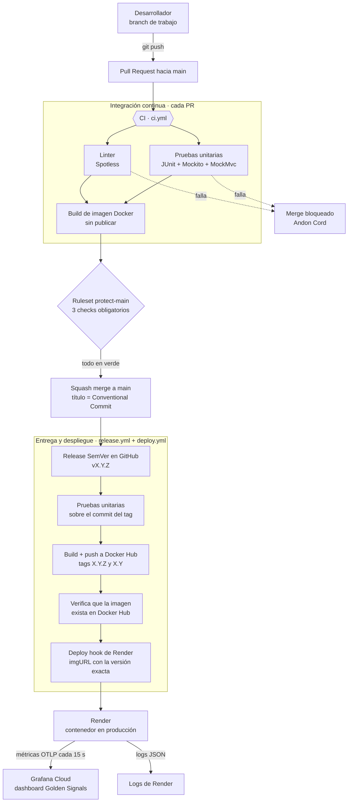
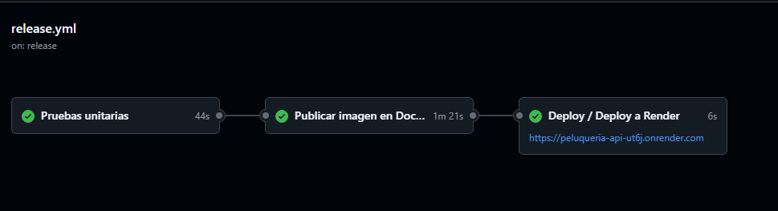
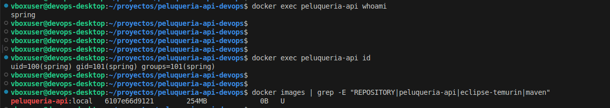
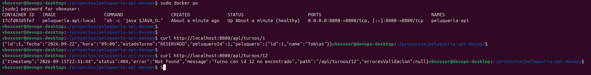
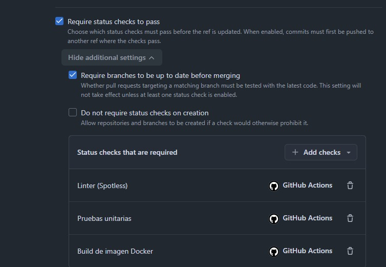
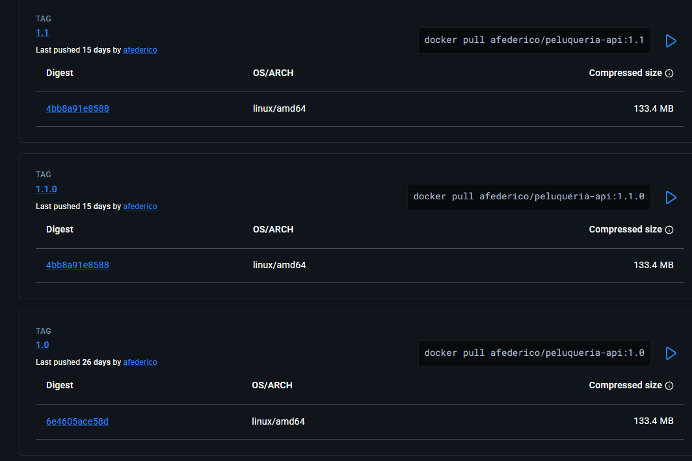
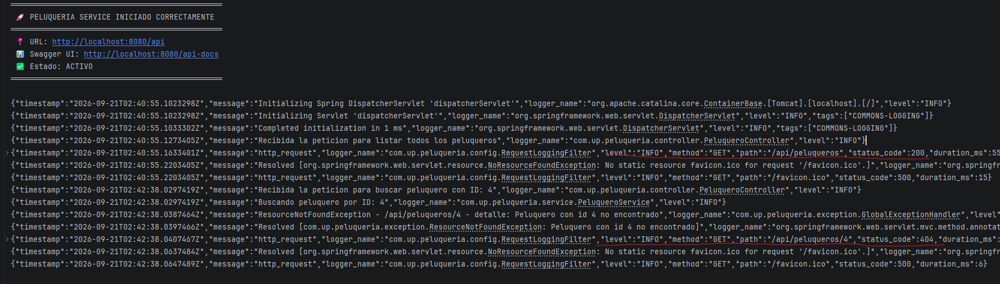
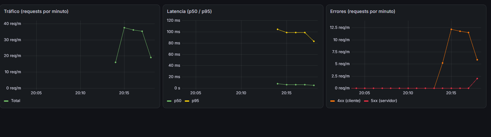
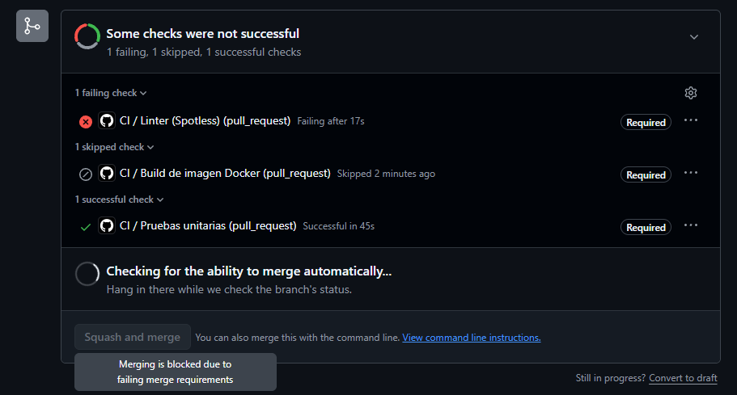
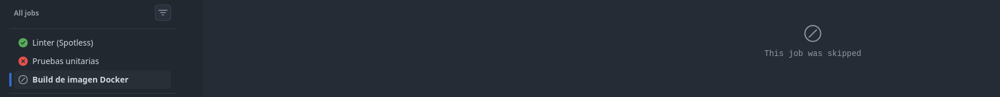

# Peluquería API — TP Integrador DevOps

API REST para la gestión de peluqueros y turnos, usada como base para aplicar el ciclo de vida DevOps de punta a punta: control de cambios, contenedores, integración y despliegue continuo, y observabilidad.

| | |
|---|---|
| **Stack** | Spring Boot 4.1.1 · Java 17 · H2 en memoria · Maven Wrapper |
| **API en producción** | https://peluqueria-api-ut6j.onrender.com |
| **Documentación interactiva (Swagger)** | https://peluqueria-api-ut6j.onrender.com/api-docs |
| **Health check** | https://peluqueria-api-ut6j.onrender.com/actuator/health |
| **Imagen Docker** | [`afederico/peluqueria-api`](https://hub.docker.com/r/afederico/peluqueria-api/tags) |
| **Dashboard (como código)** | [`observability/grafana/Peluqueria_API_Golden_Signals.json`](observability/grafana/Peluqueria_API_Golden_Signals.json) |

> El servicio de Render (plan gratuito) se suspende tras ~15 minutos sin tráfico. La primera petición puede tardar cerca de un minuto en responder mientras el contenedor arranca.

---

## Índice

1. [Cómo ejecutarlo](#1-cómo-ejecutarlo)
2. [Arquitectura del pipeline](#2-arquitectura-del-pipeline)
3. [Justificación técnica y decisiones de diseño](#3-justificación-técnica-y-decisiones-de-diseño)
4. [Observabilidad](#4-observabilidad)
5. [Aplicación de la filosofía DevOps: las Tres Formas](#5-aplicación-de-la-filosofía-devops-las-tres-formas)
6. [Principios Lean: reducción de desperdicio](#6-principios-lean-reducción-de-desperdicio)
7. [Historial de cambios y versiones](#7-historial-de-cambios-y-versiones)

---

## 1. Cómo ejecutarlo

### Con Docker Compose (un solo comando)

```bash
docker compose up --build
```

La API queda en `http://localhost:8080` y Swagger en `http://localhost:8080/api-docs`.

Para enviar métricas a Grafana Cloud, copiar `.env.example` a `.env` y completar las tres variables `GRAFANA_OTLP_*`. Sin ese archivo la aplicación funciona igual, con la exportación de métricas desactivada.

### Con la imagen publicada

```bash
docker run --rm -p 8080:8080 afederico/peluqueria-api:1.1.0
```

### Sin Docker

```bash
./mvnw spring-boot:run
./mvnw test                # 15 pruebas unitarias
./mvnw spotless:apply      # formatea el código según el linter
```

---

## 2. Arquitectura del pipeline

### Diagrama de flujo



### Componentes

| Etapa | Herramienta | Rol en el flujo |
|---|---|---|
| Control de versiones | Git + GitHub | Branches de trabajo cortas, Pull Requests y protección de `main` con un ruleset |
| Linter | Spotless (`palantirJavaFormat`) | Valida formato, imports sin usar y espacios (`spotless:check`) |
| Pruebas | JUnit 5, Mockito, MockMvc | 15 pruebas: servicio, controlador y contexto de Spring |
| Runner de CI/CD | GitHub Actions | Workflows `ci.yml`, `release.yml` y `deploy.yml` |
| Empaquetado | Docker (multi-stage) + Docker Compose | Imagen reproducible y entorno local con un comando |
| Registro de imágenes | Docker Hub | Repositorio público `afederico/peluqueria-api`, etiquetado SemVer |
| Plataforma de hosting | Render | Ejecuta la imagen publicada; el despliegue se lanza con un deploy hook |
| Observabilidad | Micrometer + OpenTelemetry (OTLP) + Grafana Cloud | Métricas HTTP y dashboard de Golden Signals |
| Logs | Logback + `logstash-logback-encoder` | Eventos JSON estructurados por cada request |

### Workflows

**`ci.yml` — se ejecuta en cada Pull Request hacia `main`.** Tres jobs: `lint` y `test` corren en paralelo, y `docker-build` depende de ambos (`needs: [lint, test]`). Si cualquiera de los dos primeros falla, la imagen no llega a construirse. Usa caché de dependencias Maven y de capas Docker (`type=gha`) para acortar el tiempo de feedback.

**`release.yml` — se ejecuta al publicar una Release en GitHub.** Vuelve a correr las pruebas sobre el commit exacto del tag, construye la imagen, la publica en Docker Hub con los tags `X.Y.Z` y `X.Y` (nunca `latest`) y llama a `deploy.yml` pasándole la versión. El job de publicación es el único con acceso a las credenciales, a través del environment `PRODUCTION`.

**`deploy.yml` — workflow reutilizable.** Valida que la versión tenga formato SemVer, verifica que la imagen exista en Docker Hub (`docker manifest inspect`) y dispara el deploy hook de Render con el parámetro `imgURL` apuntando a la imagen exacta, por ejemplo `docker.io/afederico/peluqueria-api:1.1.0`. También puede ejecutarse a mano (`workflow_dispatch`) indicando una versión, lo que permite hacer **rollback** a cualquier versión publicada sin reconstruir nada.

<!-- CAPTURA: ejecución del release con los tres jobs (test → publish → deploy) en verde -->


---

## 3. Justificación técnica y decisiones de diseño

### 3.1 Optimización del contenedor

```dockerfile
FROM maven:3.9-eclipse-temurin-17-alpine AS build
WORKDIR /app
COPY pom.xml .
RUN mvn -B dependency:go-offline
COPY src ./src
RUN mvn -B package -DskipTests

FROM eclipse-temurin:17-jre-alpine AS runtime
WORKDIR /app
RUN addgroup -S spring && adduser -S spring -G spring
COPY --from=build --chown=spring:spring /app/target/*.jar app.jar
USER spring
EXPOSE 8080
ENV JAVA_OPTS="-XX:MaxRAMPercentage=75.0"
ENTRYPOINT ["sh", "-c", "java $JAVA_OPTS -jar app.jar"]
```

**Compilación multietapa (multi-stage).** La etapa `build` tiene el JDK y Maven, que solo se necesitan para compilar. La etapa `runtime` copia únicamente el `.jar` final. Maven, el código fuente y las dependencias de compilación no llegan a la imagen que se ejecuta: es más chica y expone menos superficie de ataque.

**Imagen base ligera y específica.** Se usa `eclipse-temurin:17-jre-alpine`: solo el JRE (no el JDK) sobre Alpine Linux. Las versiones están fijadas (`3.9`, `17`) y **no se usa el tag `latest`** en ningún lado, ni en el Dockerfile ni en las imágenes publicadas, para que un build de hoy y uno de dentro de un mes partan de la misma base.

**Estrategia de capas para aprovechar la caché.** Las instrucciones están ordenadas de lo que menos cambia a lo que más cambia. Primero se copia solo el `pom.xml` y se descargan las dependencias; recién después se copia `src/`. Así, cuando cambia el código pero no las dependencias, Docker reutiliza la capa de dependencias (la más pesada, ~80 s) y solo recompila. En la práctica, un rebuild tras un cambio de código bajó de ~145 s a ~13 s.

<!-- CAPTURA: build con las capas de dependencias en CACHED -->


**Usuario sin privilegios.** La aplicación corre como el usuario `spring`, creado en la imagen, y no como `root`. Si alguien explotara una vulnerabilidad de la aplicación, quedaría limitado a los permisos de ese usuario.

**Memoria del contenedor.** Por defecto la JVM limita el heap al 25% de la memoria disponible, lo que en un contenedor de 512 MB (plan gratuito de Render) deja unos 128 MB para una aplicación Spring Boot. `-XX:MaxRAMPercentage=75.0` eleva ese tope al 75% (~384 MB) y deja el 25% restante para la memoria que la JVM usa fuera del heap (metaspace, stacks de los threads, compilador JIT), evitando que el proceso supere el límite del contenedor y sea terminado por la plataforma.

**`.dockerignore`.** Excluye `target/`, `.git` y archivos del IDE del contexto de build, lo que acelera el envío del contexto y evita invalidar la caché por archivos irrelevantes.

**Configuración por entorno.** El mismo artefacto corre en local y en producción; lo que cambia es la configuración inyectada por variables de entorno:

- `PORT` — puerto asignado por la plataforma (`server.port=${PORT:8080}`).
- `SPRING_PROFILES_ACTIVE=prod` — activa `application-prod.properties`: consola H2 apagada, sin banner (salida 100% JSON) y soporte de los headers del proxy de Render.
- `GRAFANA_OTLP_*` — credenciales de telemetría, que nunca se commitean (`.env` está en `.gitignore`).

### 3.2 Orquestación local

`docker-compose.yml` levanta el entorno completo con `docker compose up --build`. Incluye un healthcheck contra `/actuator/health`, política de reinicio y carga opcional del `.env` (`required: false`), de modo que el compose funciona aunque no se configuren las métricas.

<!-- CAPTURA: contenedor corriendo y Swagger accesible -->


### 3.3 Estrategia de integración

**Branching: Trunk-Based Development con branches de vida corta.** Hay una única rama de larga duración, `main`, que siempre debe estar desplegable. Cada cambio se hace en una branch corta (`feat/...`, `fix/...`, `ci/...`, `docs/...`) que vive horas o pocos días y entra a `main` por Pull Request. Se descartó GitFlow porque sus ramas `develop` y `release` de larga duración agregan integración tardía y burocracia que no aportan en un equipo de dos personas con despliegue continuo.

**Pull Requests documentados.** Cada PR usa la plantilla `.github/pull_request_template.md`: descripción del cambio, tipo de cambio y evidencia de pruebas (salida de `./mvnw test`, capturas).

**Squash merge y Conventional Commits.** Los PRs se integran con *squash and merge*: cada PR queda como un único commit en `main`, cuyo mensaje es el título del PR. Por eso el título debe cumplir la convención (`feat:`, `fix:`, `ci:`, `build:`, `test:`, `docs:`). El resultado es un historial lineal donde cada commit corresponde a un cambio completo y revisable.

**Protección de la rama (`protect-main`).**

| Regla | Efecto |
|---|---|
| Pull Request obligatorio | Nadie puede pushear directo a `main` |
| Status checks obligatorios: `Linter (Spotless)`, `Pruebas unitarias`, `Build de imagen Docker` | Un PR con cualquier check en rojo no se puede mergear |
| Branch actualizada antes de mergear | Los checks se validan contra la última versión de `main` |
| Bloqueo de borrado y de *force push* | El historial de `main` no se puede reescribir ni eliminar por accidente |

<!-- REVISAR antes de entregar: si el ruleset exige 1 aprobación y solo permite "Squash", agregarlo a la tabla.
     Hoy figura con 0 aprobaciones requeridas y los tres métodos de merge habilitados. -->

<!-- CAPTURA: ruleset con los tres status checks obligatorios -->


**Versionado: Semantic Versioning.** Cada versión se publica como una Release de GitHub con tag `vMAJOR.MINOR.PATCH`. El tag dispara el pipeline de release, y la imagen se publica con dos etiquetas:

- `1.1.0` — inmutable: siempre apunta a ese build exacto, garantiza reproducibilidad.
- `1.1` — se mueve a cada nuevo *patch* de esa versión menor.

**Trazabilidad de artefactos.** `docker/metadata-action` agrega a la imagen las etiquetas OCI estándar, entre ellas `org.opencontainers.image.version` y `org.opencontainers.image.revision` (el SHA del commit). Se verificó la cadena completa para `v1.0.0`:

```text
Release v1.0.0  →  tag v1.0.0  →  commit 47c85eb  →  imagen afederico/peluqueria-api:1.0.0
```

```bash
$ docker inspect --format '{{ index .Config.Labels "org.opencontainers.image.revision" }}' afederico/peluqueria-api:1.0.0
47c85ebd964c8a4ea39bc404b3e2b7574b9f6e54

$ git log --oneline -1 v1.0.0
47c85eb (tag: v1.0.0) ci: add release workflow to publish SemVer images to Docker Hub (#10)
```

<!-- CAPTURA: Docker Hub con los tags publicados -->


---

## 4. Observabilidad

### 4.1 Logs estructurados en JSON

`logstash-logback-encoder` reemplaza el formato de texto por un evento JSON por línea. Un filtro propio (`RequestLoggingFilter`) emite un evento por cada request HTTP:

```json
{"timestamp":"2026-09-21T03:52:10.123Z","level":"INFO","logger_name":"com.up.peluqueria.config.RequestLoggingFilter","message":"http_request","method":"GET","path":"/api/peluqueros/99999","status_code":404,"duration_ms":7}
```
<!-- CAPTURA: salida de logs en JSON (200 y 404) -->


### 4.2 Plataforma de monitoreo: Grafana Cloud

Spring Boot Actuator + Micrometer registran la métrica `http.server.requests` (método, URI como plantilla, status y outcome) y la **empujan por OTLP a Grafana Cloud cada 15 segundos**.

Se eligió **push en lugar de pull** (el esquema clásico de Prometheus haciendo *scraping*) porque en Render la aplicación es un único contenedor detrás de una URL pública: no hay dónde correr un Prometheus que la consulte, y exponer el endpoint de métricas a internet no es deseable. Con push, la misma configuración funciona en local y en producción cambiando solo variables de entorno. El backend de Grafana Cloud es compatible con Prometheus, así que el dashboard se consulta con PromQL.

Se habilitó el **histograma de latencia** (`percentiles-histogram`) acotado entre 5 ms y 5 s: sin buckets no se pueden calcular percentiles en el dashboard, y acotar el rango limita la cantidad de series.

### 4.3 Dashboard de Golden Signals (armado desde cero)

El dashboard se construyó panel por panel, sin plantillas, y está versionado en el repositorio como JSON importable en cualquier instancia de Grafana (el data source es una variable de entrada).

| Señal | Panel | Query (PromQL) |
|---|---|---|
| **Tráfico** | Requests por minuto | `sum(rate(http_server_requests_seconds_count{job="peluqueria", uri!~"/actuator.*"}[$__rate_interval])) * 60` |
| **Latencia** | p50 y p95 | `histogram_quantile(0.95, sum by (le) (rate(http_server_requests_seconds_bucket{job="peluqueria", uri!~"/actuator.*"}[$__rate_interval])))` |
| **Errores** | 4xx (naranja) y 5xx (rojo) por minuto | `sum(rate(http_server_requests_seconds_count{job="peluqueria", uri!~"/actuator.*", status=~"5.."}[$__rate_interval])) * 60 or vector(0)` |

<!-- CAPTURA: dashboard con tráfico real sobre la API en Render -->


---

## 5. Aplicación de la filosofía DevOps: las Tres Formas

### Primera Forma — Flujo y consistencia

**¿Qué tareas manuales quedaron 100% automatizadas?**

| Antes (manual) | Ahora (automatizado) |
|---|---|
| Revisar el formato del código a ojo | `spotless:check` en cada PR |
| Correr los tests antes de integrar | Job `Pruebas unitarias` en cada PR, y otra vez en cada release |
| Compilar y armar la imagen Docker | `docker-build` en CI; build y push en el release |
| Decidir y escribir la versión de la imagen | `metadata-action` deriva los tags del tag SemVer de la Release |
| Subir la imagen al registro | `build-push-action` con credenciales del environment |
| Desplegar en el servidor | Deploy hook de Render con la versión exacta |
| Verificar que el artefacto existe antes de desplegar | `docker manifest inspect` en `deploy.yml` |

El único paso manual es una decisión, no una tarea: **publicar la Release**, que define qué versión sale.

**¿Cómo se asegura que el entorno sea idéntico en desarrollo y en CI/CD?**

- **Una sola definición del entorno:** el mismo `Dockerfile` se usa en `docker compose` local, en el job `docker-build` de CI y en el job de publicación.
- **Imágenes base fijadas**, sin `latest`.
- **Build once, deploy anywhere:** Render no compila; ejecuta la misma imagen que se publicó en Docker Hub. Se verificó corriendo localmente la imagen `afederico/peluqueria-api:1.0.0` descargada del registro, sin compilar nada en la máquina.
- **Configuración por variables de entorno**, no por código: lo que cambia entre entornos (puerto, perfil, credenciales) se inyecta al arrancar.

### Segunda Forma — Feedback rápido y Andon Cord

**¿En qué puntos exactos el flujo "corta el cable"?**

1. **Linter (`spotless:check`)** — en cada PR. Código mal formateado o con imports sin usar no avanza, aunque compile y pase las pruebas.
2. **Pruebas unitarias** — en cada PR. Un test fallido detiene el flujo.
3. **`needs: [lint, test]` en `docker-build`** — si falla cualquiera de los anteriores, la imagen no se construye: el artefacto defectuoso no llega a existir.
4. **Ruleset de `main`** — los tres checks son obligatorios: GitHub deshabilita el botón de merge mientras alguno esté en rojo.
5. **`needs: test` en el release** — antes de publicar se vuelven a correr las pruebas sobre el commit del tag; si alguien etiqueta un commit roto, la imagen no llega a Docker Hub.
6. **Validaciones en `deploy.yml`** — si la versión no es SemVer válida o la imagen no existe en el registro, el deploy no se dispara.

<!-- CAPTURA: PR #9 con el linter en rojo, build en skipped y "Merging is blocked" -->


**Si la API empieza a responder 5xx o con latencia alta, ¿qué lo detecta y mediante qué señal?**

Lo detecta **Grafana Cloud** mediante **métricas**: la serie `http_server_requests_seconds_count` con `status=~"5.."` alimenta el panel de errores (línea roja), y los buckets del histograma alimentan los percentiles p50/p95. Como la aplicación envía métricas cada 15 segundos y el dashboard se refresca cada 10, un aumento de errores o de latencia se ve en menos de un minuto. Para diagnosticar el detalle, cada request queda además en los **logs JSON** con su `path`, `status_code` y `duration_ms`, consultables en los logs del servicio en Render.

<!-- Si se configura una alerta en Grafana sobre la tasa de 5xx, mencionarla acá: es la señal que avisa sin tener el dashboard abierto. -->

### Tercera Forma — Aprendizaje y simulación de fallos

Se realizaron experimentos de falla controlada para verificar que el sistema reacciona como se espera, y se documentaron fallos reales detectados por la propia instrumentación.

**Experimento 1 — Test unitario roto (PR #4).** Se cambió intencionalmente un valor esperado en `PeluqueroServiceTest` (`"Mateo"` → `"Pedro"`). **Reacción:** el job `Pruebas unitarias` falló, `Build de imagen Docker` quedó en *skipped* y el PR no pudo integrarse. Se revirtió con `git revert` y el pipeline volvió a verde.

<!-- CAPTURA: PR #4 con el test fallido -->


**Experimento 2 — Fallo de linter con código funcional (PR #9, cerrado sin mergear).** Se agregó un import sin usar en `PeluqueroController`. El código compilaba y las pruebas pasaban. **Reacción:** `Linter (Spotless)` falló en 17 segundos, el build quedó en *skipped* y GitHub mostró *"Merging is blocked due to failing merge requirements"*. Demuestra que el estándar de calidad se aplica aunque el código funcione.

**Hallazgo 3 — Un bug real detectado por las métricas (PR #7).** Al consultar en Grafana apareció una serie `status="500"` con `uri="/**"`. La causa: una ruta inexistente lanzaba `NoResourceFoundException`, que no tenía handler propio y caía en el handler genérico, que responde 500. Sin la corrección, cualquier URL mal escrita o escaneo automatizado habría contado como error del servidor, contaminando la señal de 5xx. Se agregó un handler que devuelve 404 y un test de regresión.

**Hallazgo 4 — Una falla silenciosa diagnosticada sin adivinar (PR #6).** Al integrar las métricas, la aplicación arrancaba y pasaba las pruebas, pero no llegaba ningún dato a Grafana y no había ningún error en los logs. Con el endpoint `/actuator/conditions` se vio que la autoconfiguración del exportador OTLP estaba descartada por una clase faltante: en Spring Boot 4, `micrometer-registry-otlp` no alcanza y se necesita `spring-boot-starter-opentelemetry`.

**Hallazgo 5 — Problemas que solo aparecen en producción (PR #13).** Al desplegar en Render se detectaron cuatro problemas que no se veían en local: métricas que no llegaban (los logs mostraban `HTTP connect timed out` cada 15 s, porque el timeout por defecto de 1 s no alcanzaba para el handshake TLS desde un contenedor con poca CPU), Swagger enviando requests a `localhost`, URLs `http://` bloqueadas detrás del proxy HTTPS de Render, y un `System.out` que rompía el formato JSON de los logs. Los cuatro se corrigieron en un PR.

**Aprendizaje sobre el propio proceso.** El PR #6 se integró con el CI en rojo, porque en ese momento los status checks todavía no eran obligatorios. Ese caso motivó activarlos en el ruleset: desde entonces, un PR en rojo no puede llegar a `main`.

---

## 6. Principios Lean: reducción de desperdicio

**1. Defectos detectados tarde (*muda* de defectos).** Un error que llega a producción cuesta mucho más que uno detectado al escribirlo. *Cómo se evita:* el linter y las pruebas corren en cada PR y bloquean el merge; las pruebas se repiten antes de publicar; y en producción, las métricas exponen errores en menos de un minuto. El bug del 500 en rutas inexistentes (PR #7) se detectó por métricas antes de que lo reportara un usuario.

**2. Esperas y trabajo manual repetitivo (*muda* de espera y de sobreprocesamiento).** Compilar, armar la imagen, etiquetarla, subirla y desplegarla a mano implica esperas y pasos propensos a error en cada versión. *Cómo se evita:* desde que se publica la Release hasta que la versión está en producción no hay intervención humana. La caché de capas Docker y de Maven en CI reduce los tiempos de build (de ~145 s a ~13 s en un rebuild local tras un cambio de código).

**3. Configuración manual de servidores e inconsistencia entre entornos (*muda* de inventario y retrabajo).** Configurar cada máquina a mano produce el clásico "en mi máquina funciona". *Cómo se evita:* el entorno es código versionado (`Dockerfile`, `docker-compose.yml`, workflows, el propio dashboard como JSON); cualquier integrante levanta el entorno con un comando, y producción ejecuta exactamente la imagen publicada.

**Lotes pequeños.** Todo el proyecto se integró en PRs chicos y de un solo propósito (logs, métricas, dashboard, fix del 404, release, deploy), cada uno revisable por separado y fácil de revertir si algo salía mal.

---

## 7. Historial de cambios y versiones

Todo el historial de `main` sigue Conventional Commits:

```text
fix: production readiness for Render deployment (#13)
ci: split release pipeline into publish and deploy workflows (#12)
feat(config): add prod profile and bind server port to PORT env var (#11)
ci: add release workflow to publish SemVer images to Docker Hub (#10)
feat(observability): add Golden Signals Grafana dashboard as code (#8)
fix: return 404 for unknown routes instead of 500 (#7)
feat(metrics): export HTTP metrics to Grafana Cloud via OTLP (#6)
feat(logs): emit structured JSON logs for HTTP requests (#5)
ci: add CI workflow with lint, tests and docker build (#4)
test: add unit tests for peluqueros service and controller (#3)
build: add Docker multi-stage image and docker-compose (#2)
feat: import peluqueria API base (#1)
docs: add initial README
```

| Versión | Contenido |
|---|---|
| `v1.0.0` | API, pruebas, Docker, CI, logs JSON, métricas, dashboard y publicación en Docker Hub |
| `v1.1.0` | Perfil de producción, pipeline de despliegue a Render por deploy hook y correcciones de producción |

El PR #9 se cerró sin mergear: fue el experimento de Andon Cord por linter.

---

*Trabajo Práctico Integrador — DevOps · Universidad de Palermo*
